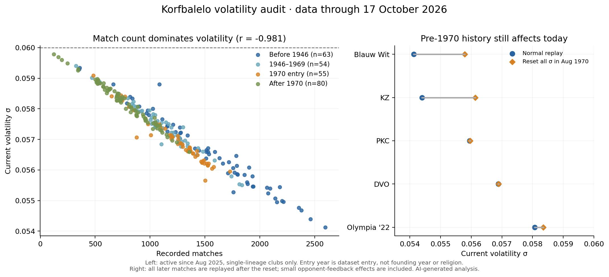
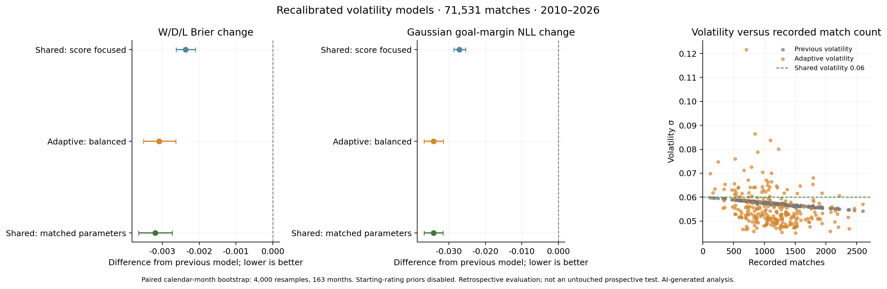
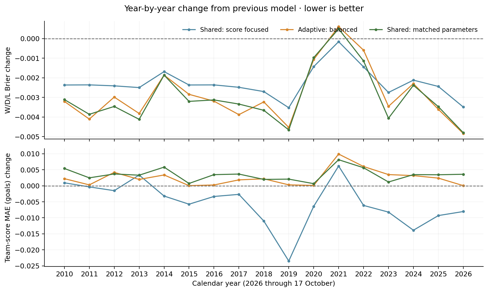

# [korfbalelo.nl](https://korfbalelo.nl)

First, a disclaimer:
 - This is a hobby project that started somewhere in 2018 and has escalated quite a bit over the years
 - The code is exactly like that of a hobby project: chaotic, illogical, incorrect, sparsely documented, and appearing to be written by an insane lunatic (me)
 - From 2026 onwards, most changes are AI generated and possibly even more incoherent and overly complicated than I could've ever done
 - PRs are welcome and will be looked at. They will also be frowned upon, because who in their sane mind would go through the effort trying to understand this mess?
 - Complaints about the state of the codebase will be met with maniacal laughter.

For a nice explanation of what this all about anyway, see [korfbalelo.nl](https://korfbalelo.nl).

The following is AI generated (because I'm lazy) and could be partly or totally wrong:

`Korfbal Elo` is a Kotlin + Vue project for rating Dutch korfbal teams, predicting match outcomes, and simulating league finish probabilities (champion/promotion/relegation).

It combines:
- A Kotlin rating/simulation engine (`src/main/kotlin`)
- Data ingestion (historical files + KNKV portal API scraping with cache)
- A Vue 3 frontend (`web/`) that serves and visualizes generated artifacts

## Stack

- Kotlin JVM (Gradle, Java toolchain 25)
- Vue 3 + TypeScript + Vite + Pinia
- Data files in CSV/TXT/JSON (many are generated and committed)

## Prerequisites

### Java 25 via sdkman

This repo is configured for Java 25 in `build.gradle.kts` and CI.

```bash
sdk list java | grep -E "25.*(tem|open|zulu)"
sdk install java <candidate>
sdk use java <candidate>
java -version
```

### Node.js

Root and frontend both pin Node major version `26` via `.nvmrc`.

```bash
nvm use
node -v
```

`npm >= 10` is recommended. `npm 8` works but prints engine warnings for `npm-run-all2`.

## Quick Start

### Backend

```bash
./gradlew clean test
./gradlew run
```

- `run` executes `nl.korfbalelo.elo.ApplicationNew`
- It recalculates ratings and writes web-consumed artifacts like:
  - `web/public/ranking.csv`
  - `web/public/graph.csv`
  - `web/public/meta.json`
  - `web/src/origins.ts`
  - `aggr/*.csv`

### Season prediction export

```bash
./gradlew predict --args="2026-01-01"
```

- Runs `nl.korfbalelo.elo.SeasonPredicter`
- Generates season probability CSVs/JSON under `web/public/csv/...` and `web/public/*.json`
- Note: CI currently passes a second argument (`zaal`) but `SeasonPredicter.main` only uses the first argument (date)

### Frontend

```bash
cd web
npm ci
npm run dev
```

Useful checks:

```bash
cd web
npm run build
npm run lint
```


## Quality Gates

Baseline gates (fast PR feedback):

- `./gradlew test`
- `cd web && npm run build`

For output-producing backend changes also run:

- `./gradlew run`
- `./gradlew predict --args="2026-01-01"`

See `docs/quality-gates.md` for details and invariants.
CI contract note: PR pipeline enforces earliest-date guard + predict determinism by default; add PR label `changes generated match output` to intentionally skip those contract checks.

## Architecture Overview

### 1) Event + match ingestion

- Historical data: `matches/*.txt|csv`
- Club lifecycle commands (spawn/merge/alias/end): `club_events.txt`
- Current season scrape: `src/main/kotlin/nl/korfbalelo/mijnkorfbal/Scraper.kt`
  - Uses validated raw-response cache files under `cache/knkv-v2-*.json`
  - Writes `matches/current.txt` and `web/public/specials<indoor-season>.json`

### 2) Rating engine

- Entrypoint: `src/main/kotlin/nl/korfbalelo/elo/ApplicationNew.kt`
- Team model + Glicko-style update: `src/main/kotlin/nl/korfbalelo/elo/Team.kt`
- Match application + alias mapping: `src/main/kotlin/nl/korfbalelo/elo/RankingNew.kt`
- Event parsing/execution: `src/main/kotlin/nl/korfbalelo/elo/RankingEvent.kt`

### 3) Season simulation

- Kotlin simulator/exporter: `src/main/kotlin/nl/korfbalelo/elo/SeasonPredicter.kt`
- Poule simulator core: `src/main/kotlin/nl/korfbalelo/elo/PoulePredicter.kt`
- Outputs consumed by frontend:
  - `web/public/csv/<season>/<poule>.csv`
  - `web/public/<season>.json`
  - `web/public/meta.json`

### 4) Frontend

- Vue app shell/routes: `web/src/App.vue`, `web/src/router/index.ts`
- Data stores: `web/src/stores/*`
- Season + what-if simulator:
  - `web/src/simulator/SeasonSimulator.ts`
  - `web/src/simulator/PoulePredicter.ts`
  - `web/src/simulator/SimulationWorker.ts`

Important: promotion/relegation logic exists in both Kotlin (`SeasonPredicter.kt`) and frontend TS (`SeasonSimulator.ts`) and should stay aligned.

## Repo Layout

- `src/main/kotlin/nl/korfbalelo/elo`: rating engine, event model, simulation, exports
- `src/main/kotlin/nl/korfbalelo/mijnkorfbal`: KNKV portal API models + scraper
- `src/test/kotlin`: minimal tests (some disabled)
- `matches/`: historical + current match data files
- `web/`: Vue frontend
- `web/public/`: generated and static data served by frontend
- `.github/workflows/`: CI and scheduled daily update workflow

## CI/CD

- `.github/workflows/pr.yml`
  - Java 25
  - `./gradlew build`
  - generated-output contracts:
    - `./.ci/check_generated_csv_guard.py <base-ref>`
    - `./.ci/check_predict_determinism.sh`
    - optional PR label override: `changes generated match output`
  - `web: npm ci && npm run build`
- `.github/workflows/daily-check.yml`
  - Runs `./gradlew -Delo.scraper.forceNetwork=true scrape`
  - If `matches/current.txt` changed (including removed/corrected results), trims outdoor season CSV history from the earliest changed date and runs `./gradlew predict --args="$EARLIEST_DATE veld"`
  - Commits and pushes updated data artifacts
  - Forces fresh KNKV portal API reads (`-Delo.scraper.forceNetwork=true`) and saves cache snapshot key `knkv-cache-v2-<os>-daily-*`
  - Other workflows restore the latest successful daily scrape snapshot (they do not overwrite it)

<!-- AI generated: KNKV portal migration and operational controls. -->
## KNKV Scraper

The official portal API base is `https://api-saas-site-prod-236.dotlab.net/general/api/competition`.
The scraper validates the success envelope and endpoint payload before caching it. Results are
flat matches; programme responses contain week groups. Match dates use the API's local `date`,
and unplayed fixtures retain scores of `-1`. Requests are paced at five per second with bounded
retries for rate limits and temporary gateway failures. Failed scrapes leave match output and
published in-memory competition data untouched.

The legacy `KNKV-DISTRICT-OOST` filter now labels nationwide **B-category** competitions.
The outdoor SN and RN pool names/IDs match the previous cached source (67 and 156 pools,
respectively, checked October 11, 2026). Both teams must still end in ` 1` to enter Elo input.
The versioned `static-poules/zaal2627.json` remains the default indoor source. Upcoming live
pools with no standings, results, or programme are skipped as unpublished; published matches
without standings still cause a clear failure.

A fresh live check can write both match and specials output outside the checkout:

```bash
./gradlew -Delo.scraper.forceNetwork=true -Delo.scraper.outputDirectory=/tmp/knkv-check scrape
```

Other scraper properties:

- `elo.scraper.apiBase`: override the API base for a future endpoint move.
- `elo.scraper.cacheDirectory`: override the cache directory (default `cache`).
- `elo.scraper.useStaticIndoorPoules=false`: explicitly test all live indoor sources.
- `elo.scraper.writeCurrentMatches=false`: suppress match-file writes.
- `elo.scraper.writeSpecialMatches=false`: suppress specials-file writes as well.
- `elo.scraper.requestIntervalMillis`: minimum interval between requests (default `200`).

## License

Source code is licensed under the MIT License; see [LICENSE](LICENSE).

Match data, fixture data, ranking data, generated CSV/JSON artifacts, and other
data/content files are published for transparency and reproducibility. They may
include data derived from third-party or public sources. Reuse of those
data/content files is not covered by the MIT source-code license.

## Known Caveats

- `SeasonPredicter.doOutdoor` is hardcoded (`false`) unless changed in code.
- Test coverage is limited; `GlickoTest` is disabled.
- Large generated data files can change often; avoid unrelated formatting churn.
- `web/dist` and `web/node_modules` are build outputs and should not be committed.

## Verified Commands (current workspace)

These passed during doc creation:

- `./gradlew clean test`
- `cd web && npm ci && npm run build`

## Glicko investigation — 2026-11-01 (AI generated)

The default model now uses **margin scale 360** (previously 400) and a **score-learning
weight cap of 4** (previously unlimited). The remaining defaults are unchanged.
Full configurations, development results, later-period results, date clusters,
season summaries, and bootstrap comparisons are in
[`benchmarks/glicko-2026-11-01/`](benchmarks/glicko-2026-11-01/).

### What the current calculation does

This is a sequential, margin-aware adaptation of Glicko-2, rather than textbook
win/draw/loss Glicko-2:

1. Before a match, `Team.setNewRD` increases squared normalized RD by elapsed days
   divided by `rdPeriodDays`, multiplied by volatility squared. RD is capped at 350.
2. A normal goal-difference distribution uses each team's learned scoring pace:
   team score SD = `0.166 * averageScore + 1.85`. Monthly offsets adjust scoring pace.
   Its mean is `differenceSD * inverseNormalCDF(p)`, where
   `p = 1 / (1 + 10^((awayRating - homeRating - H) / marginScale))`.
3. The match result becomes a fractional Glicko score:
   `normalCDF(actualGoalDifference / differenceSD)`. A narrow win is weaker evidence
   than a large win; the predicted mean cancels out of this transformation.
4. `Glicko2Calculator` computes opponent-RD attenuation, expected score, information,
   volatility, posterior RD and rating. Both teams use their opponents' pre-update
   ratings. Home advantage learns after the away-side update has been calculated.
5. Scoring pace learns from the team's goal residual. A daily cross-team regression
   also supplies a small goal-based rating adjustment. Ratings are recentered daily.

The volatility root solver agrees structurally with
[Glickman's reference](https://www.glicko.net/glicko/glicko2.pdf).
The calculator omits the reference's additional per-update volatility inflation;
this application already ages RD by elapsed time before updating. Adding another
full period per match would change the time model and can double-count aging.
The one-game fractional-score updates and calendar-day periods are deliberate
adaptations that need empirical validation; textbook Glicko-2 recommends batches.
No change to the volatility solver or an extra per-match inflation was made.

### Why bounded scoring-pace learning helps

Previously, the goal residual was multiplied by `v * g = 1 / (g * E * (1-E))`
and divided by 100. This multiplier grows rapidly in uneven matchups, letting those
games dominate scoring-pace learning. It is always at least 4. Consequently,
a cap of 4 makes the learning rate a stable **4% of the goal residual per match**.
The Glicko rating and RD equations themselves remain unchanged; subsequent ratings
can change through the learned scoring pace and the existing goal-based adjustment.
Caps 4, 8, 16 and 32 were tested; 4 gave the best development team-score error.

A smaller margin scale sharpens forecast probabilities. Scale 360 with the cap
provided a useful balance between probability quality and predicted goal errors.
The browser playoff fallback and backend declarative playoff fallback now use the
configured scale too; the browser retains 400 for older metadata without a scale.
New metadata records the score-learning cap.

### Method and results

First ran 27 ablations, then 19 interaction variants on **96,623 matches**, evaluating
2000-08-01 through 2022-08-01. Earlier events trained the model. Four finalists were
frozen before inspecting the later period: original baseline, cap only, balanced
360 + cap, and probability-focused 320 + SD coefficients 0.12/1.5 + cap.

Later-period evaluation requested 2022-08-01 through 2026-11-01; the available played
matches actually span **2022-09-10 through 2026-10-17**, totaling **16,674 matches**.
Every prediction is recorded before that match updates the model. All variants
use the same events and daily recentering. Lower is better for the four error metrics.

| Later-period metric | Original | Cap only | New default (360 + cap) | Probability-focused candidate |
| --- | ---: | ---: | ---: | ---: |
| Three-outcome Brier | 0.409093 | 0.408170 | **0.404770** | 0.401882 |
| Log loss | 0.709068 | 0.707565 | **0.701685** | 0.693145 |
| Goal-margin MAE | 4.182477 | 4.178350 | **4.154313** | 4.180452 |
| Per-team score MAE | 3.390786 | 3.295007 | **3.281762** | 3.293694 |
| Win/draw/loss accuracy | 70.70289% | 70.66691% | **70.65491%** | 70.57695% |

The new default improves Brier **1.06%**, log loss **1.04%**, margin MAE **0.67%**,
and team-score MAE **3.22%** relative to the original. WDL classification drops
0.048 percentage points (eight predictions); this is an improvement in probability
and score quality, with essentially unchanged classification accuracy.
The probability-focused candidate remains available in `finalists`, but was not
chosen as the default because it provides less improvement in margin prediction.

The balanced model improves all four error metrics in each season slice:
2022–23, 2023–24, 2024–25, 2025–26 and partial 2026–27. Its development Brier,
margin MAE and team-score MAE were 0.435306, 3.724715 and 3.019077, compared with
0.439099, 3.726555 and 3.055818 for the original.

Paired bootstrap resampling of **42 calendar-month clusters**, 4,000 samples,
seed 20261101, gives these approximate 95% intervals for new minus original:

| Metric | Difference | Interval |
| --- | ---: | ---: |
| Brier | -0.004323 | [-0.004918, -0.003729] |
| Log loss | -0.007383 | [-0.008549, -0.006157] |
| Margin MAE | -0.028163 | [-0.038418, -0.018521] |
| Team-score MAE | -0.109024 | [-0.125409, -0.093180] |

### Benchmark fixes and limits

The old benchmark set `ignoreMatchesBelow` to the evaluation start, discarding
rating updates from earlier history. Both benchmark entrypoints now retain earlier
training matches and exclude events after the evaluation end. A regression test
checks that moving the evaluation start changes the measured matches without
changing the final trained rating, and that future games are excluded.

`startratings.csv` is fitted using later results by `StartRatingFinder`, so replay
with these priors is not strictly out of sample. Repeated all four finalists with
those priors removed: original versus balanced Brier was **0.409206 → 0.404871**,
log loss **0.709231 → 0.701838**, margin MAE **4.183550 → 4.154784**, and team-score
MAE **3.390658 → 3.282039**. The same improvements survive this sensitivity check.
The development search still used the fitted priors; this is historical validation,
not an untouched prospective experiment. Later-period selection between finalists
also means the final choice should now be monitored on future matches.

Month resampling preserves dependence within a month, but not dependence across
months or repeated clubs throughout a season. The intervals are descriptive,
not proof of generalization. Matches have dates rather than kickoff timestamps;
same-date results are processed in file order. Results mix indoor and outdoor games
and do not yet establish separate calibration for each competition or tier.

Slower RD growth did not help: periods of 7 and 14 days raised development Brier
to 0.456359 and 0.465694. Removing seasonality worsened team-score MAE from 3.055818
to 3.227325. Removing the score-based rating tweak slightly worsened Brier.
Home-advantage learning changes gave negligible gains. These mechanisms were kept.

### Further worthwhile experiments

- Evaluate probability calibration by rating gap, RD, competition, and season type.
  Direct match forecasts use point ratings; season simulations additionally sample
  rating uncertainty. Test integrating uncertainty into direct forecasts, separately
  from changing the update equations.
- Fit score variance and draw probabilities independently from rating updates.
  Currently the same SD controls fractional learning targets, margin predictions,
  and draw probabilities, so optimizing one objective can worsen another.
- Separate attack/scoring pace from defensive strength, and consider robust or
  count-based goal likelihoods. The current pace update mixes own and opponent pace;
  the scalar goal-based rating tweak can reward high-scoring styles.
- Replace outcome-fitted spawn priors with causal priors based only on information
  available when a club enters. Evaluate newcomers separately.
- Validate day-batched updates and season-boundary uncertainty against sequential
  calendar aging, with a future period reserved before additional tuning.

### Reproduction and verification

Use Java 25. The CSV rows include full model configurations. Finalist order is
0 = original, 1 = cap only, 2 = new default, 3 = probability-focused candidate.
`research` and `refine` intentionally retain the original reference defaults.
Scoring-tweak and seasonality settings come from system properties; the checked-in
results use their normal production settings.

```bash
# AI generated: discovery, interaction search, then frozen finalist evaluation.
./gradlew benchmarkModel --args=research -Delo.benchmark.from=2000-08-01 -Delo.benchmark.to=2022-08-01 -Delo.benchmark.output=build/development.csv
./gradlew benchmarkModel --args=refine -Delo.benchmark.from=2000-08-01 -Delo.benchmark.to=2022-08-01 -Delo.benchmark.output=build/refinement.csv
./gradlew benchmarkModel --args=finalists -Delo.benchmark.from=2022-08-01 -Delo.benchmark.to=2026-11-01 -Delo.benchmark.byDate=true -Delo.benchmark.output=build/holdout.csv
./gradlew benchmarkModel --args=finalists -Delo.benchmark.from=2022-08-01 -Delo.benchmark.to=2026-11-01 -Delo.benchmark.fittedStarts=false -Delo.benchmark.byDate=true -Delo.benchmark.output=build/holdout-unfitted.csv
python3 benchmarks/analyze_glicko.py build
```

Restore the original runtime behavior with
`-Delo.model.marginRatingScale=400 -Delo.model.scoreLearningWeightCap=Infinity`.

Verification: `./gradlew clean test` completed with 62 passing tests and two skipped;
frontend `npm run build` and all 15 frontend tests passed. Rating output and a
current-season prediction export with two deterministic iterations completed in a
disposable repository copy. Exported metadata showed scale 360 and cap 4, and
34 indoor poule CSVs contained the 2026-11-01 snapshot. These iterations only verify
the export path, not Monte Carlo convergence. The prescribed January 2026 snapshot
failed because current poules reference WKS before it exists in that historical
ranking. No production ranking, graph, match, metadata or season CSV artifacts in
this checkout were regenerated; only the benchmark CSVs are new generated outputs.

## Volatility investigation — 2026-11-01 (AI generated)

**Finding:** the volatility parameter mostly tracks accumulated match history, rather
than measuring each club's present tendency to change strength. This is already
present in the original model, and is not introduced by the calibration changes
above. The arithmetic volatility solver agrees with independent bisection; the
problem is the application of Glicko-2 volatility estimation to individual,
fractional-score matches. No production rating behavior was changed by this audit.



### Measurements

Replayed all available events through 2026-11-01 (last played match 2026-10-17),
using the branch's model: margin scale 360, score-learning cap 4, and otherwise
normal settings. The diagnostic replay reproduces the existing benchmark's
Brier, log loss and goal errors exactly.

- All **333 clubs remaining in the ranking** have sigma below the initial 0.06.
- Across **612,588 team updates**, sigma decreases **97.1483%** of the time,
  increases **2.7705%**, and otherwise remains equal at floating-point precision.
  These are updates across the entire history, not only the recent evaluation window.
- For **320 clubs with a match since 2025-08-01**, correlation between game count
  and sigma is **-0.69456**. Restricting to **252 single-lineage clubs** gives
  **-0.98086**. Multi-origin club mergers sum predecessor match counts but average
  their sigmas, so their game totals do not represent one volatility-update chain.
- A linear fit of `1 / sigma^2` against game count explains **96.45%** of its
  variation among those single-lineage clubs:
  `1 / sigma^2 ≈ 275.638 + 0.025229 * recordedMatches`.
- Repeating the original margin-400/unbounded-score model gives correlation
  **-0.98111**, confirming that this predates the recent improvements.

Examples from the current replay:

| Club | Dataset entry | Recorded matches | Sigma |
| --- | --- | ---: | ---: |
| Blauw Wit | 1918-09-29 | 2598 | 0.0541282 |
| KZ | 1911-10-15 | 2463 | 0.0543944 |
| PKC | 1970-05-31 | 1729 | 0.0559505 |
| Dalto | 1970-08-30 | 1580 | 0.0561031 |
| DVO | 1970-09-06 | 1277 | 0.0568838 |
| Olympia '22 | 1928-01-15 | 902 | 0.0580738 |

Dataset entry is not founding date. Nor does entry year alone classify a club's
religious background. The 1970 entrants lie on much the same match-count curve as
other clubs. Olympia's comparatively high sigma despite entering in 1928 shows
that sparse recorded history matters more than calendar age.

The big entry cohort in `club_events.txt` is in 1970, especially 1970-08-30 and
1970-09-06. Historically, competitions were integrated in **1970/71** and the
formal CKB/KNKB merger was **1 July 1973**, rather than 1969. See the
[Nationaal Archief's account](https://www.nationaalarchief.nl/onderzoeken/archief/2.19.266/beschrijving/context).

### Why it happens

Volatility is the process-noise parameter: how much true strength can move over
time. RD is uncertainty about strength. More observations naturally reduce RD;
that does not imply that an older club's underlying strength changes more slowly.

The numerical objective in `Glicko2Calculator.updatedVolatility` uses the correct
Glicko-2 expression and Illinois root procedure. Its direction of change depends
on how the squared improvement estimate compares with existing uncertainty and
game variance. With the current symbols, the objective at the previous sigma has
the sign of `delta^2 - phi^2 - v - sigma^2`.

For **one match against an equally rated opponent**, expected score is 0.5:

- `v = 4 / g^2`;
- `delta = 4 * (score - 0.5) / g`;
- therefore `delta^2 / v = 4 * (score - 0.5)^2 <= 1` for every score in [0,1].

Thus `delta^2 <= v`, and adding positive `phi^2` and `sigma^2` makes the objective
negative. **A single equal-strength matchup lowers sigma for every possible
result, including a win or loss.** An upset against sufficiently unequal ratings
can raise it, so the behavior is not literally monotonic.

With rating 1500, RD 100, sigma 0.06 against an identical opponent:

| Result supplied to Glicko | New sigma |
| --- | ---: |
| Win, score 1 | 0.059999710 |
| Draw, score 0.5 | 0.059995898 |
| Loss, score 0 | 0.059999710 |

Fractional results near 0.5 produce stronger downward evidence. Korfbalelo supplies
`normalCDF(goalDifference / goalDifferenceSD)` as a score, rather than 0/0.5/1.
The volatility likelihood nevertheless uses Bernoulli information `E * (1-E)`.
As a reference calculation, a correctly scaled normal margin at equal strength
transforms into a uniform [0,1] score: variance 1/12, versus 1/4 for a binary result.
That is a likelihood mismatch, not evidence that the club is becoming stable.

Across 609,738 initialized-player updates, the mean
`(fractionalScore - E)^2 / (E * (1-E))` is **0.24667**. Replacing the fractional
result with win/draw/loss for this diagnostic gives **0.75926**. The former supplies
much less volatility-growth evidence. These descriptive ratios do not by
themselves separate score smoothing, predictive calibration and temporal strength
changes; both are affected by the fitted ratings and their uncertainty.

The [Glicko-2 reference](https://www.glicko.net/glicko/glicko2.pdf) estimates volatility
from batches and recommends a moderate-to-large number of games per period,
roughly 10–15 per player. A batch can accumulate repeated surprising results before
estimating variance. Korfbalelo updates sigma after each match and has no explicit
mechanism for forgetting old evidence. The small updates therefore accumulate
into a persistent match-count effect. Fractional scores amplify the downward drift.
Binary-only volatility evidence in the replay reduces the drift, but still leaves
a **-0.97964** correlation with game count: binary scoring alone is not a remedy.

Calendar uncertainty aging is also a custom adaptation: RD already grows with
elapsed days before the update, whereas the reference inflates it using the newly
estimated volatility per rating period. This audit does not claim full equivalence
to textbook Glicko-2. Adding another full inflation step per match would not repair
the score-likelihood/batching mismatch and would change the time model too.

### Why the cohort difference persists

As a counterfactual, set every existing club's sigma to 0.06 on 1970-08-30, then
replay exactly the same subsequent events and results:

| Club | Normal present sigma | Present sigma after 1970 reset |
| --- | ---: | ---: |
| Blauw Wit | 0.0541282 | 0.0557866 |
| KZ | 0.0543944 | 0.0561303 |
| PKC | 0.0559505 | 0.0559643 |
| DVO | 0.0568838 | 0.0568887 |
| Olympia '22 | 0.0580738 | 0.0583488 |

The reset still affects present values **56 years later**. It raises sigma for
120 of 121 recently active single-lineage clubs entering before that reset.
The median increase is 0.0003370, and the maximum is 0.0017359.
Later entrants change slightly through opponent-feedback effects.

This is accumulated recorded-history dependence, not a special CKB rule or a
persistent difference proving that Christian clubs change strength differently.
Cohort medians are not universally ordered by age: pre-1946 clubs have median
sigma 0.056520, 1946–1969 entrants 0.057433, and 1970 entrants 0.056741, reflecting
uneven coverage and match counts. These comparisons exclude multi-origin clubs.

### Practical consequences and counterfactual benchmarks

The parameter is not a direct measure of unpredictable match scores. It controls
uncertainty growth and consequently later learning rates and simulation spread.
In this application, added RD variance is
`(173.7178 * sigma)^2 * elapsedDays / rdPeriodDays`.
At sigma 0.0541282, the added variance is about **18.6% lower** than at 0.06.
Holding other parameters equal, RD 100 ages over 120 days to **143.56** rather than
**151.78**. This is a real, unintended coverage-based difference, although the
resulting changes to match predictions are small.

Ran 15 development variants on 96,623 matches from 2000-08-01 through 2022-07-31:
learned sigma; shared values 0.04/0.05/0.055/0.06/0.065/0.075/0.09; mean reversion
with 1/5/10-year half-lives; a 0.055 floor; resets in 1970/2000; and binary-only
volatility evidence. Shared 0.06, shared 0.075 and five-year reversion were retained
for later comparison alongside the reset/binary mechanism controls.

All interventions are isolated in the diagnostic event wrapper. Fixed sigma is
set before and after each match. Reversion pulls log sigma towards log(0.06) using
the elapsed days before each match; the resulting sigma is then used for that
entire gap's RD aging. It is an experimental endpoint approximation, not a fitted
continuous-time volatility process. Binary evidence uses the original fractional
rating update and only substitutes the binary score for the volatility estimate.
First encounters with an unrated team retain the original volatility update in
that diagnostic variant. Resets happen after existing events on the reset date.

Results on the 16,674 later matches (2022-09-10 through 2026-10-17):

| Volatility policy | Brier | Log loss | Margin MAE | Team-score MAE |
| --- | ---: | ---: | ---: | ---: |
| Existing learned | 0.404770 | 0.701685 | 4.154313 | 3.281762 |
| Shared 0.06 | 0.404424 | 0.701055 | 4.153421 | 3.281012 |
| Shared 0.075 | 0.403299 | 0.698657 | 4.157348 | 3.280751 |
| Five-year reversion | 0.404477 | 0.701152 | 4.153572 | 3.281132 |

Shared 0.06 improves later Brier by **0.085%** and log loss by **0.090%**.
Its paired calendar-month bootstrap Brier difference is -0.0003453, with an
approximate 95% interval [-0.0004267, -0.0002640]. The margin-error difference is
-0.0008922 with interval [-0.0020361, 0.0002105], so no meaningful margin gain is
established. Shared 0.075 improves probability scores more, but worsens development
margin MAE and is not an unqualified improvement. The point of this experiment
is whether individualized volatility supplies useful signal, not retuning the
whole model around a different time scale.

Removing outcome-fitted starting ratings gives the same conclusion: learned
versus shared 0.06 Brier is **0.404871 → 0.404519**, log loss **0.701838 → 0.701198**.
This is retrospective validation on a previously inspected later period, not a new
untouched holdout. Bootstrap samples use 42 calendar-month clusters, 4,000 draws
and seed 20261101; dependence across months/clubs limits their interpretation.

### Assessment and reproduction

There is **no demonstrated arithmetic bug in the volatility solver**. There is a
**model-design issue** if sigma is presented or relied on as a measure of each
club's current strength variability. It largely encodes archive coverage, and
that history-dependent differentiation is not justified by the current likelihood.

The simplest practical remedy is a shared, calibrated volatility, initially 0.06,
while retaining team-specific RD. It removes this historical bias and performed
at least comparably here, with a small improvement in probability losses. Its
interpretation is a common strength-drift rate, not learned per-club volatility.
For actual adaptive per-club volatility, investigate period/batch updates or a
margin likelihood with calendar-time process noise and explicit forgetting.
That requires validation of the whole time/observation model. Merely increasing
tau, resetting in 1970, or clipping sigma does not correct the statistical model.

Production behavior is deliberately unchanged in this investigative change.
The benchmark makes each alternative reviewable before adopting a policy.

```bash
# AI generated: all commands read the versioned dataset and only write diagnostic outputs.
./gradlew investigateVolatility --args=baseline -Delo.benchmark.from=2022-08-01 -Delo.benchmark.to=2026-11-01 -Delo.benchmark.output=build/volatility-baseline
./gradlew investigateVolatility -Delo.benchmark.from=2000-08-01 -Delo.benchmark.to=2022-07-31 -Delo.benchmark.output=build/volatility-development
./gradlew investigateVolatility --args=finalists -Delo.benchmark.from=2022-08-01 -Delo.benchmark.to=2026-11-01 -Delo.benchmark.byDate=true -Delo.benchmark.output=build/volatility-holdout
./gradlew investigateVolatility --args=finalists -Delo.benchmark.from=2022-08-01 -Delo.benchmark.to=2026-11-01 -Delo.benchmark.fittedStarts=false -Delo.benchmark.byDate=true -Delo.benchmark.output=build/volatility-unfitted
./gradlew investigateVolatility --args=baseline -Delo.model.marginRatingScale=400 -Delo.model.scoreLearningWeightCap=Infinity -Delo.benchmark.from=2022-08-01 -Delo.benchmark.to=2026-11-01 -Delo.benchmark.output=build/volatility-original
python3 benchmarks/analyze_volatility.py
```

The analysis script reads the checked-in `benchmarks/volatility-2026-11-01/`
snapshot by default; pass another directory containing `holdout/` and `unfitted/`
to regenerate comparisons and the figure from another replay. Plot generation
requires matplotlib. CSVs include full retained team snapshots, policy summaries,
and date-cluster losses. `facts.json`, `cohorts.csv`, and `comparisons.csv` reproduce
the principal statistics.

Regression checks establish the equal-opponent decrease, an extreme-upset increase,
three independent numerical fixtures, agreement with independent bisection across
200 varied matchups, and additive calendar RD aging. `./gradlew clean test` and
the frontend build pass. No production data artifacts were regenerated.

## Shared versus per-match goal-margin volatility — 2026-11-01 (AI generated)

Both alternatives are implemented and jointly recalibrated. **A calibrated shared
volatility is the simpler recommendation.** The new adaptive update greatly reduces
lifetime match-count dependence, but does not establish an improvement over a
matched, recalibrated constant-volatility control. There is no single winner on
all forecast metrics. Existing default behavior is retained; the new complete
configurations can be selected with `-Delo.model.profile=...`.



### Primary comparison: 2010 onward

At the user's request, the primary performance window is now **2010-01-01 onward**.
Pre-2010 events remain training history and contribute no matches to these metrics.
There are **71,531 played matches**, through 2026-10-17. This descriptive replay uses
the same frozen models; no parameters were reselected using the combined 2010–2026
results. The search already weighted 2012-onward development performance heavily.
The combined window includes development years, so the later 2022-08-01 onward
comparison below remains the stronger check on selection-period overfitting.

| Model | Brier | WDL log loss | Margin MAE | Team-score MAE | Gaussian margin NLL | 95% coverage |
| --- | ---: | ---: | ---: | ---: | ---: | ---: |
| Existing branch model | 0.421742 | 0.730703 | **3.975928** | 3.181275 | 3.086143 | 97.746% |
| Shared, score-focused | 0.419369 | 0.724604 | 3.981469 | **3.175808** | 3.058988 | 96.326% |
| Shared, matched parameters | 0.418541 | 0.722164 | 3.988379 | 3.184619 | **3.051881** | 95.531% |
| Adaptive, balanced | 0.418652 | 0.722536 | 3.984276 | 3.183466 | 3.051897 | 95.515% |
| Adaptive, probability-focused | **0.418500** | **0.721118** | 3.994680 | 3.190238 | 3.066102 | 92.816% |

The adaptive probability-focused candidate narrowly wins the full-period Brier
point estimate and WDL log loss, but its score errors are worse and its 95% margin
interval covers only 92.82% of results. The matched shared profile has almost the
same Brier and substantially better goal-interval calibration. The score-focused
shared profile remains best for team-score MAE. The existing model remains best
for absolute margin error among these main candidates. There is no metric-independent
winner; the recommendation for the simpler shared family still depends on valuing
probability/calibration quality over a few thousandths of a goal in point errors.

Brier by calendar-year group (2026 is partial):

| Years | Matches | Existing | Shared, score-focused | Shared, matched | Adaptive, balanced |
| --- | ---: | ---: | ---: | ---: | ---: |
| 2010–2015 | 30,805 | 0.434991 | 0.432706 | 0.431710 | 0.431841 |
| 2016–2021 | 22,036 | 0.416820 | 0.414344 | 0.413644 | 0.413623 |
| 2022–2026 | 18,690 | 0.405710 | 0.403311 | 0.402609 | 0.402845 |

These groups use complete calendar years, so their last group includes early 2022;
it is not identical to the separate August-2022-onward evaluation below.
The individual-year analysis is important: matched shared and balanced adaptive
have slightly worse Brier than the existing model in **2021** (1,340 matches),
although both improve in most other years. The aggregate does not imply universal
improvement across interruptions, competitions, or years.



In the direct 2010-onward comparison with identical other parameters, adaptive
minus matched shared is +0.000111 Brier (approximate month-bootstrap interval
[-0.000033, +0.000258]), +0.000372 WDL log loss ([+0.000159, +0.000583]),
-0.004103 margin MAE ([-0.005975, -0.002337]), and -0.001153 team-score MAE
([-0.001793, -0.000501]). Gaussian margin NLL differs by only +0.000016, with an
interval containing zero. Thus adaptation trades a small improvement in goal
point errors for worse WDL log loss; it is not an across-the-board gain. These
intervals use 163 calendar-month clusters and include selection-period data.

Production-prior robustness also agrees: with fitted starting ratings, existing
versus matched shared Brier is **0.421542 → 0.418454** and WDL log loss
**0.730403 → 0.722044**. See the raw summaries for exact values and all other metrics.

Full individual calendar years are in `calendar-years.csv`; the grouped results
are in `periods.csv`. Raw per-date losses for the two `since-2010` replays are
compressed as `.csv.gz`, which the analysis script reads transparently.

### Per-match adaptive calculation

`GoalMarginVolatility` updates after each individual completed match. Both sides
use the same pre-match forecast, pre-match RDs, and pre-match volatility values.
There is no batching, delayed use of the score, or lookahead.

Let the conditional normal goal-margin model have mean `m` and SD `s`. Its mean is
`m = s * inverseNormalCDF(p)`, with `p = logistic(log(10) * ratingGap / marginScale)`.
The local sensitivity of expected goal margin to a rating point is

`h = s * log(10) / marginScale * p * (1-p) / normalDensity(m/s)`.

Approximate the predictive variance including uncertainty in both strengths by

`V = s^2 + h^2 * (RD_own^2 + RD_opponent^2)`.

Let `Q_own` be the own-team rating variance added during calendar aging since the
last match. Without the RD cap, this is `(173.7178 * sigma)^2 * elapsedDays / rdPeriodDays`.
The local Gaussian log-likelihood score for log process variance is

`score = 0.5 * (h^2 * Q_own / V) * ((actualMargin - m)^2 / V - 1)`.

Update `log(sigma^2)` by `learningRate * score`, with a maximum absolute step of
0.5, then constrain sigma to [0.015, 0.20]. With no elapsed-time variance exposure,
there is no volatility update. The opponent gets its own score weighted by its
own process-variance exposure. The match score is observed only after the forecast
has been recorded.

Before the next match, log sigma reverts towards its configured initial value
using elapsed calendar days and a calibrated half-life. This supplies finite
memory instead of an indefinite archive-length effect. As in the earlier reversion
experiment, the gap-end sigma is used for the entire gap's aging; this is an
endpoint approximation, not an exact continuous-time integral.

Under the assumed predictive Gaussian, the **unclipped score has expectation zero**,
because `E[(actualMargin - m)^2 / V] = 1`. Unlike the old rule, a sufficiently
surprising margin raises volatility even against an equally rated opponent. Quiet
matches can lower it. Clipping and parameter bounds are stability measures and can
introduce bias; they do not inherit an exact unbiasedness guarantee.

This is a local score-driven surrogate, not a claim to a fully Bayesian filter.
The mean rating/RD update still uses the existing fractional-score Glicko mechanism.
The predictive variance uses local linearization, and at an RD cap the effective
added variance is treated as locally scalable rather than differentiating through
the hard cap. A single match cannot uniquely identify which opponent's strength
changed or separate all irreducible goal noise from strength drift. The derivative
and zero-mean tests establish the stated local calculation, not that these latent
volatilities are ground truth. The general use of predictive likelihood scores for
sequential parameter updates is discussed in
[this primary research paper](https://academic.oup.com/biomet/article/102/2/325/246771).

### Calibration and selection

All earlier matches train the model. Starting-rating priors from `startratings.csv`
were disabled throughout parameter selection. Development scoring covers
**96,623 matches from 2000-08-01 through 2022-07-31**. Within that period, the
predeclared selection objective weights all-period Brier/log loss at 20% each and
2012-onward Brier/log loss at 30% each, normalized to the existing model.

For each family, retain both a probability-focused candidate and a candidate with
these development guards: margin MAE and team-score MAE at most 0.2% worse than
the existing model; 2012-onward margin MAE at most 0.5% worse. "Balanced" refers
to those development guards, not guaranteed dominance on later seasons.

Four stages contain **674 attempted development evaluations**, including repeated
references: 97 grid runs, 221 coordinate runs, 219 second-pass runs, and 137 seeded
local interaction runs. Two unstable configurations failed the whole replay, giving
672 completed evaluations. These failures used an excessive score-based rating
adjustment rate; they are saved in `refine2/failures.jsonl`. No matches were dropped
to make a candidate succeed. The initial interrupted second-pass attempt was rerun
and is not an additional completed search stage.

The searches cover shared sigma and adaptive prior sigma, margin scale, score SD
slope/intercept, scoring-pace learning, home advantage and its learning speed, RD
cap, initial RD fraction, the goal-based rating adjustment and RD scaling, and
seasonal adjustment learning/caps/half-lives. The adaptive family additionally
searches its learning rate and calendar memory. `rdPeriodDays` remains 1: jointly
scaling it and shared sigma is redundant through `sigma^2 / rdPeriodDays`.
Volatility stability bounds and step cap were not tuned.

After selecting the four family finalists, a matched constant-volatility control
was calibrated on development data at sigma 0.04/0.05/0.06/0.07/0.08/0.09, retaining
all other parameters from the balanced adaptive model. Sigma 0.06 was selected.
The resulting ten candidates/controls were frozen before this round's later-period
comparison. `selection.json`, `finalists.json`, full configurations for every run,
and all raw result CSVs are retained in
[`benchmarks/volatility-model-comparison-2026-11-01/`](benchmarks/volatility-model-comparison-2026-11-01/).

### Later-period results

Evaluation requested 2022-08-01 through 2026-11-01; available results span
2022-09-10 through 2026-10-17, totaling **16,674 matches**. Lower is better for losses
and MAEs. The nominal 95% goal-margin interval should cover approximately 95% of
results. Gaussian NLL here scores the existing point-rating forecast's conditional normal
margin density at the integer result; it does not add RD variance to that forecast.
The adaptive update additionally accounts for local RD uncertainty through V.
This is not an exact joint-score or rounded-normal probability score.

| Model | Brier | WDL log loss | Margin MAE | Team-score MAE | Gaussian margin NLL | 95% coverage |
| --- | ---: | ---: | ---: | ---: | ---: | ---: |
| Existing branch model | 0.404871 | 0.701838 | 4.154784 | 3.282039 | 3.123078 | 97.781% |
| Shared, probability-focused | 0.401800 | 0.693121 | 4.192314 | 3.356139 | 3.112863 | 92.395% |
| Shared, score-focused | 0.402302 | 0.695557 | 4.162699 | **3.272661** | 3.096563 | 96.132% |
| Adaptive, probability-focused | 0.401731 | **0.692834** | 4.183003 | 3.295943 | 3.107910 | 92.509% |
| Adaptive, balanced | 0.401806 | 0.693926 | 4.164071 | 3.284983 | **3.090050** | 95.262% |
| Shared, matched parameters | **0.401554** | 0.693291 | 4.166685 | 3.285042 | 3.090089 | 95.280% |

The matched shared profile improves Brier by **0.819%**, WDL log loss by **1.218%**,
and Gaussian margin NLL by **1.056%** relative to the existing branch model.
Its margin MAE is **0.286% worse** (+0.01190 goals), and team-score MAE **0.092%
worse** (+0.00300 goals). These small point-error costs must not be described as
improvements. The score-focused shared profile instead gives a small improvement
in per-team score error, with less improvement in probability losses.
The adaptive probability profile gives the lowest WDL log loss, but has notably
under-covering goal intervals. No candidate dominates every objective.

The matched comparison is particularly useful: adaptive minus shared, with all
other parameters equal and the shared sigma selected on development data:

| Metric | Difference | Approximate paired-month 95% interval |
| --- | ---: | ---: |
| Brier | +0.000252 | [-0.000032, +0.000533] |
| WDL log loss | +0.000635 | [+0.000234, +0.001043] |
| Margin MAE | -0.002614 | [-0.006341, +0.000880] |
| Team-score MAE | -0.000060 | [-0.001474, +0.001341] |
| Gaussian margin NLL | -0.000040 | [-0.000891, +0.000804] |

Thus individualized adaptation does not establish useful forecast gains over the
matched constant model here. Its Brier point estimate is worse, though that
interval includes zero; its WDL log loss is worse, and its tiny goal-likelihood
advantage is indistinguishable from zero under this resampling scheme.
The shared versus existing-model Brier difference is -0.003317 with interval
[-0.004298, -0.002365].

The new volatility still varies across clubs: the balanced adaptive profile spans
approximately **0.0450–0.1216** among recently active single-lineage clubs, versus
the old model's narrow age-driven band. Its correlation with recorded match count
is **-0.275**, versus **-0.982** for the old update. This is much less lifetime
count dependence, not proof that the new numbers measure intrinsic club instability.

The fitted-start robustness run agrees. Existing model versus matched shared gives
Brier **0.404770 → 0.401527**, WDL log loss **0.701685 → 0.693266**, Gaussian NLL
**3.122975 → 3.090021**, margin MAE **4.154313 → 4.166569**, and team-score MAE
**3.281762 → 3.284910**. Adaptive balanced remains slightly worse than its matched
shared control on probability losses.

This is retrospective evaluation on a period already inspected in earlier work,
not an untouched prospective test. There are many searched settings and reported
objectives. Paired bootstrap intervals use 4,000 resamples of 42 calendar months
with NumPy generator seed 20261101; serial dependence across months/clubs limits
interpretation. Full per-season results are saved rather than asserting universal
dominance across every season or competition.

### Available profiles and recommendation

Complete optional profiles are bundled in `src/main/resources/rating-profiles.json`.
Individual `elo.model.*` system properties override the selected profile.

| Setting | Existing default | `shared-matched` | `goal-margin-balanced` | `shared-balanced` |
| --- | ---: | ---: | ---: | ---: |
| Volatility mode | legacy | shared | goal-margin | shared |
| Shared sigma / adaptive prior | 0.06 initially | 0.06 | 0.0825 | 0.066 |
| Adaptive learning rate | n/a | n/a | 4 | n/a |
| Adaptive half-life | n/a | n/a | 730 days | n/a |
| Margin rating scale | 360 | 320 | 320 | 360 |
| Score SD slope | 0.166 | 0.12 | 0.12 | 0.136 |
| Score SD intercept | 1.85 | 1.9 | 1.9 | 1.85 |
| RD maximum | 350 | 450 | 450 | 350 |
| Initial RD / maximum | 0.5 | 0.75 | 0.75 | 0.5 |
| Home advantage | 35 | 35 | 35 | 35 |
| Home advantage learning speed | 1/64 | 1/64 | 1/64 | 0 |
| Seasonal offset learning rate | 0.0025 | 0.0025 | 0.0025 | 0.005 |

Scoring-pace inverse speed 100, weight cap 4, and goal-based rating adjustment
rate 0.001 remain unchanged in these three profiles after searching alternatives.
The shared profile ignores adaptive learning/memory fields retained in its JSON.
The two probability-focused profiles are also bundled as `shared-probability` and
`goal-margin-probability`, with the stated point-error/coverage tradeoffs.

For probability and interval quality, prefer **`shared-matched`**: it removes the
archive-length parameter effect without extra per-club state learning and gives
the lowest later Brier among the frozen candidates. Prefer **`shared-balanced`**
when per-team point-score error matters more. Keep the adaptive profile available
for further experiments; the tested complexity is not justified by these results.
No default switch is made merely because one objective improves.

```bash
# AI generated: optional complete profiles, forwarded to run/predict by Gradle.
./gradlew run -Delo.model.profile=shared-matched
./gradlew run -Delo.model.profile=goal-margin-balanced
./gradlew predict --args="2026-11-01" -Delo.model.profile=shared-balanced
```

Both backend and browser simulations use the same exported volatility policy for
calendar aging. New metadata records the mode, prior/shared value, adaptive memory,
learning rate, bounds, and initial RD fraction. Older metadata keeps legacy behavior.

### Reproduction and verification

Use Java 25. Search stages disable fitted starting ratings by default. Parameter
selection and matched-control choice are entirely before the later replay.

```bash
# AI generated: the first search creates selected.json for each coordinate stage.
./gradlew calibrateVolatility --args=search -Delo.benchmark.from=2000-08-01 -Delo.benchmark.to=2022-07-31 -Delo.benchmark.byDate=true -Delo.benchmark.output=build/volatility-calibration/search
./gradlew calibrateVolatility --args=refine -Delo.benchmark.configs=build/volatility-calibration/search/selected.json -Delo.benchmark.from=2000-08-01 -Delo.benchmark.to=2022-07-31 -Delo.benchmark.byDate=true -Delo.benchmark.output=build/volatility-calibration/refine
./gradlew calibrateVolatility --args=refine -Delo.benchmark.configs=build/volatility-calibration/refine/selected.json -Delo.benchmark.from=2000-08-01 -Delo.benchmark.to=2022-07-31 -Delo.benchmark.byDate=true -Delo.benchmark.output=build/volatility-calibration/refine2
python3 benchmarks/calibrate_volatility.py polish
./gradlew calibrateVolatility --args=polish -Delo.benchmark.configs=build/volatility-calibration/polish-input.json -Delo.benchmark.from=2000-08-01 -Delo.benchmark.to=2022-07-31 -Delo.benchmark.byDate=true -Delo.benchmark.output=build/volatility-calibration/polish
python3 benchmarks/calibrate_volatility.py freeze
python3 benchmarks/calibrate_volatility.py prepare-controls
./gradlew calibrateVolatility --args=evaluate -Delo.benchmark.configs=build/volatility-calibration/development-finalists.json -Delo.benchmark.from=2000-08-01 -Delo.benchmark.to=2022-07-31 -Delo.benchmark.byDate=true -Delo.benchmark.output=build/volatility-calibration/development-finalists
python3 benchmarks/calibrate_volatility.py freeze-control
# The archived finalists.json contains this development-selected matched constant control.
./gradlew calibrateVolatility --args=evaluate -Delo.benchmark.configs=benchmarks/volatility-model-comparison-2026-11-01/finalists.json -Delo.benchmark.from=2022-08-01 -Delo.benchmark.to=2026-11-01 -Delo.benchmark.byDate=true -Delo.benchmark.output=build/volatility-calibration/later
# Repeat the preceding command with -Delo.benchmark.fittedStarts=true and another output directory.
./gradlew calibrateVolatility --args=evaluate -Delo.benchmark.configs=benchmarks/volatility-model-comparison-2026-11-01/finalists.json -Delo.benchmark.from=2010-01-01 -Delo.benchmark.to=2026-11-01 -Delo.benchmark.byDate=true -Delo.benchmark.output=build/volatility-calibration/since-2010
# Repeat with fittedStarts=true for the corresponding production-prior robustness replay.
MPLCONFIGDIR=/tmp/kotlinelo-matplotlib python3 benchmarks/analyze_volatility_models.py
```

The analysis script defaults to the archived snapshot; optionally pass another root
containing `later/` and `later-fitted/`. It also reads `since-2010/` and
`since-2010-fitted/` when present. It needs NumPy and matplotlib. Profile tests
verify that model, scoring adjustment and seasonality settings are loaded together,
that explicit properties override them, and that unknown profiles fail clearly.
Gradient tests check the derivative against finite differences, zero expected
unclipped score, symmetric outcomes, increases for large equal-strength surprises,
no update without process exposure, bounds, and both sides' pre-match state.
Backend/frontend preparation share numerical test fixtures.

Full exports for `shared-matched` and `goal-margin-balanced` were exercised in
separate disposable copies, and their metadata was checked against these settings.
The adaptive season export uses two deterministic iterations as an output-path
smoke test, not a Monte Carlo accuracy assessment. No production ranking, graph,
metadata, match or season CSV artifacts in this checkout are regenerated by these
experiments; benchmark files are the new generated outputs.
